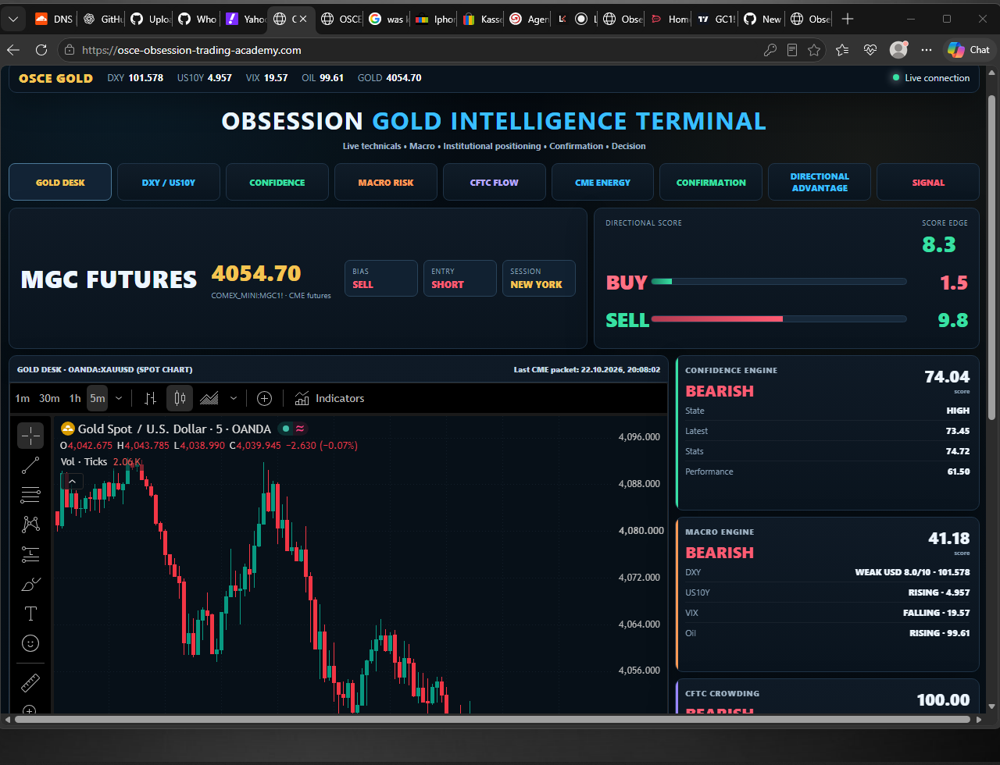
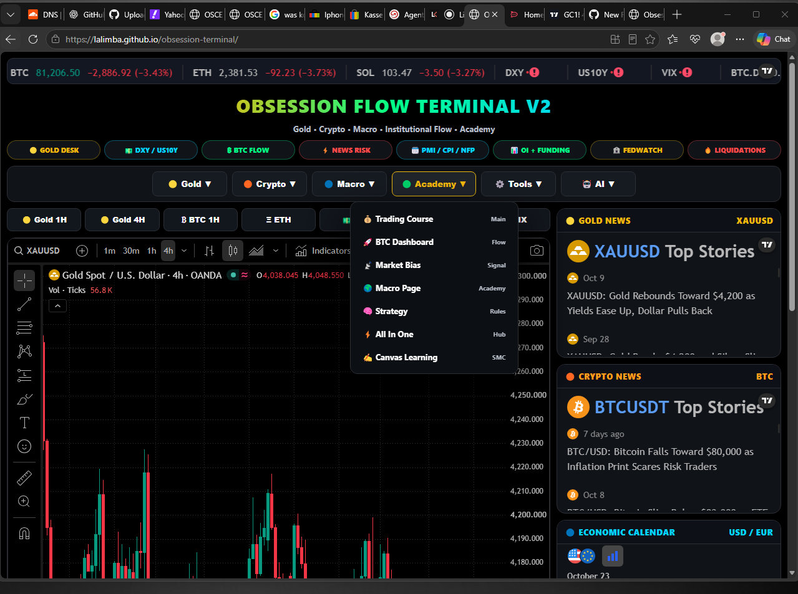
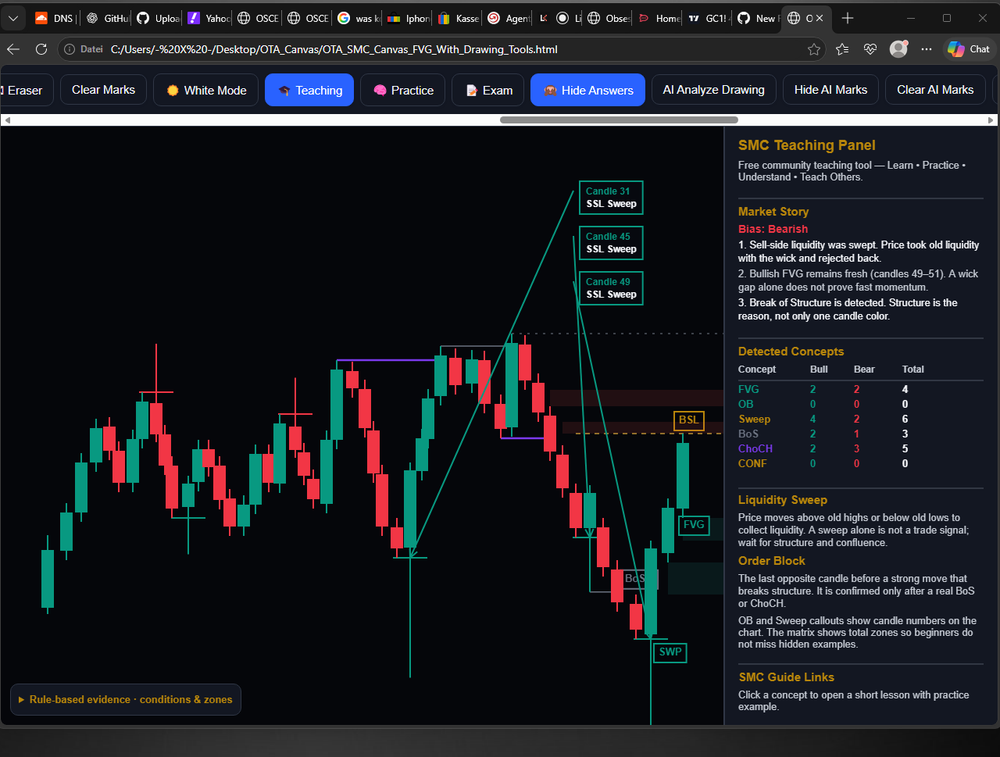
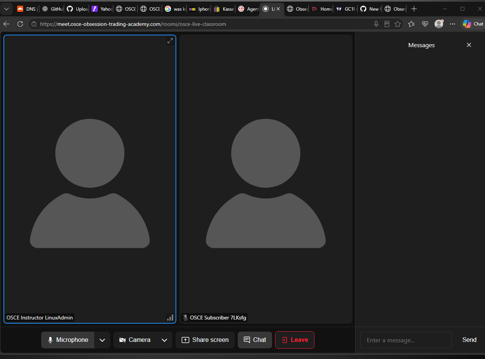
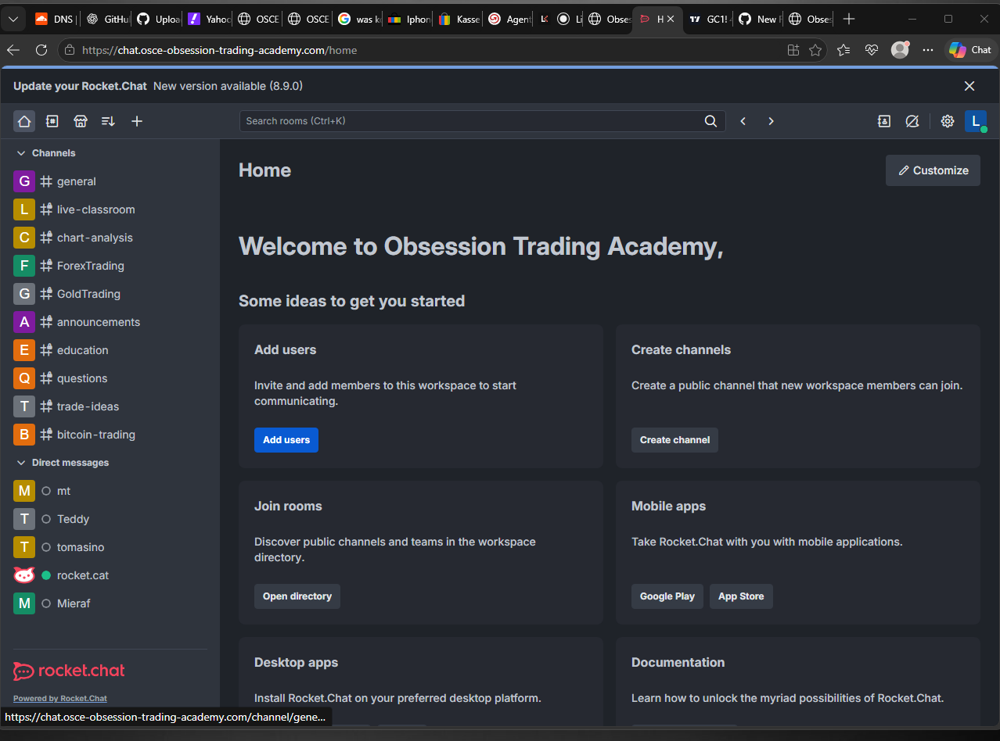
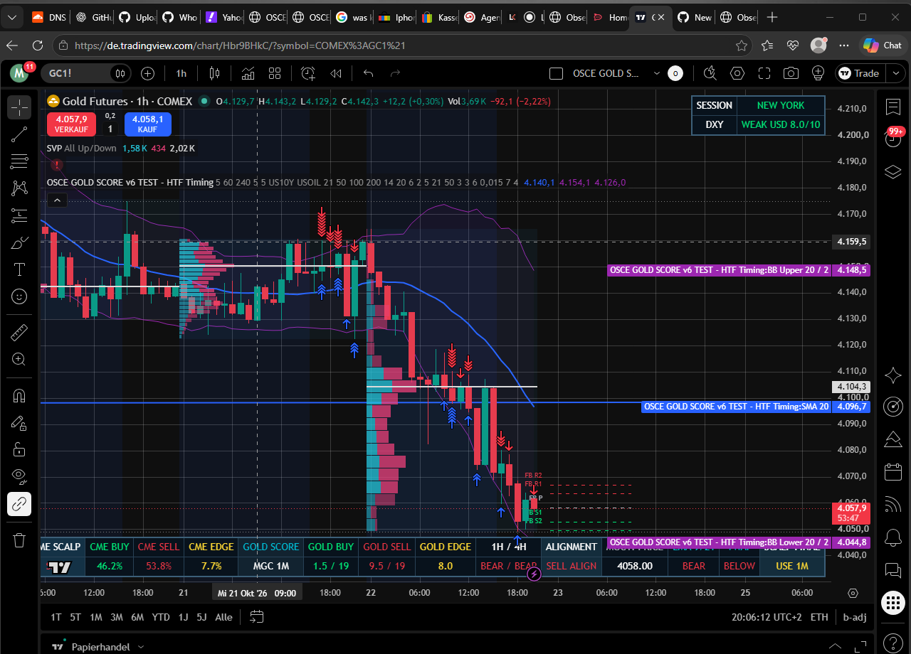

# Trading Systems Developer | Linux Infrastructure Engineer

### Python · Financial Market Technology · Real-Time Data · DevOps

🇩🇪 **Based in Germany | Stuttgart Region**  
💼 **Open to part-time opportunities: 20–25 hours/week**  
🌍 **On-site · Hybrid · Remote Germany**

---

## 👨‍💻 About Me

I am an independent developer with a background in IT, programming, electronics, Linux infrastructure, and extensive practical experience in financial markets.

I design, develop, deploy, and maintain trading research applications, real-time financial dashboards, and self-hosted communication platforms.

My work combines financial market knowledge with software engineering, backend development, data processing, networking, and infrastructure administration.

## 🚀 Featured Projects

### 🥇 OSCE Gold Intelligence Terminal

**Self-hosted financial market intelligence and trading research platform**

- Gold futures and spot market monitoring
- Multi-factor directional scoring and confidence engines
- DXY, US10Y, VIX, oil, and macroeconomic analysis
- Market structure and CME-derived signal calculations
- Real-time dashboard and backend data integration
- Authenticated access and session controls

🌐 [OSCE Trading Academy](https://osce-obsession-trading-academy.com)

### 📊 Obsession Flow Terminal V2

**Multi-asset trading dashboard hosted on GitHub Pages**

- BTC, ETH, gold, and cryptocurrency monitoring
- TradingView chart integration
- Open Interest, funding, and liquidation dashboards
- Macroeconomic indicators and financial news
- Interactive trading research interfaces

🌐 [Live Dashboard](https://lalimba.github.io/obsession-terminal/)

💻 [GitHub Repository](https://github.com/lalimba/obsession-terminal)

### 🐍 Python Trading Research & Backtesting

- Historical OHLCV data processing
- Multi-timeframe market analysis
- Market structure, liquidity, and momentum research
- Strategy testing and performance evaluation
- Custom financial data processing tools

### 🖥️ Linux Server & Application Infrastructure

- Ubuntu Linux server administration
- Nginx reverse proxy and HTTPS
- PostgreSQL database integration
- Docker and containerized services
- API integrations and WebSocket communication
- Remote networking and access control

### 🎥 Real-Time Classroom & Communication

- Self-hosted LiveKit and WebRTC
- Instructor-controlled video classroom
- Role-based participant permissions
- Rocket.Chat community infrastructure
- Authentication and backend access control

## 🛠️ Technical Skills

**Programming:** Python · Java · C++ · JavaScript · Pine Script

**Infrastructure:** Linux · Docker · Nginx · PostgreSQL · Git · Networking

**Backend & Communication:** REST APIs · WebSockets · WebRTC · LiveKit · Rocket.Chat

**Financial Technology:** Market Data · Trading Systems · Backtesting · Market Structure · Order Flow

---

## 🇩🇪 Berufliches Profil

Softwareentwicklung und Linux-Systemadministration mit Schwerpunkt auf Finanzmarkt-Technologie, Python, Echtzeit-Datenverarbeitung und selbstgehosteten Anwendungen.

Praktische Erfahrung in der Entwicklung und Integration von Trading-Dashboards, Analysewerkzeugen, Backend-Diensten und Kommunikationsplattformen.

**Gesucht:** Teilzeitbeschäftigung mit 20–25 Stunden pro Woche im Raum Stuttgart, in Baden-Württemberg oder deutschlandweit 
im Homeoffice.

**Interessengebiete:** Trading-Systeme, FinTech, Python-Entwicklung, Linux-Administration, Backend-Entwicklung und technische Plattformbetreuung.

---

## 🖥️ Engineering Project Portfolio

Selected projects combining financial market technology, software development, Linux infrastructure, and real-time communication.

<table>
<tr>
<td width="50%" valign="top">

### 🥇 OSCE Gold Intelligence Terminal

**Self-hosted market intelligence platform**

- Gold futures and spot market analysis
- Custom directional and confidence scoring
- Macro monitoring: DXY, US10Y, VIX, Oil
- Real-time dashboard and backend integration

**Focus:** Trading Systems · Linux · Market Data

[View Platform](https://osce-obsession-trading-academy.com/)

</td>
<td width="50%" valign="top">

### 📊 Obsession Flow Terminal V2

**Multi-asset trading dashboard**

- Gold, BTC, ETH and cryptocurrency monitoring
- Interactive TradingView chart integration
- Funding, Open Interest and macro dashboards
- Market news and trading education tools

**Focus:** Frontend · APIs · Financial Data

[Live Demo](https://lalimba.github.io/obsession-terminal/)

</td>
</tr>
<tr>
<td width="50%" valign="top">

### 🧠 OSCE Intelligent Canvas

**Trading analysis and research application**

- Chart analysis and research workflows
- Trading strategy exploration
- Market structure interpretation
- AI-assisted analytical functionality

**Focus:** Trading Research · Software Integration

</td>
<td width="50%" valign="top">

### 🎥 OSCE LiveKit Classroom

**Self-hosted real-time classroom**

- LiveKit and WebRTC communication
- Instructor-controlled participation
- Participant authentication and permissions
- Browser-based video and audio

**Focus:** WebRTC · Backend · Linux

</td>
</tr>
<tr>
<td width="50%" valign="top">

### 💬 OSCE Rocket.Chat

**Self-hosted collaboration infrastructure**

- Community messaging and discussions
- User access management
- Persistent messaging services
- Integration with academy infrastructure

**Focus:** DevOps · Docker · Networking

</td>
<td width="50%" valign="top">

### 📈 TradingView CME & DXY Indicators

**Custom technical analysis tools**

- Pine Script indicator development
- Custom CME-derived energy calculations
- DXY and multi-timeframe confirmation
- Market structure and signal scoring

**Focus:** Pine Script · Market Analysis

</td>
</tr>
</table>

---

### 🇩🇪 Professional Opportunities

**Available for part-time employment (20–25 hours/week)** in trading technology, Python development, financial software engineering, or Linux infrastructure.

**Location:** Stuttgart Region · Baden-Württemberg · Remote Germany

*Engineering projects focused on practical solutions, continuous learning, and reliable software infrastructure.*
